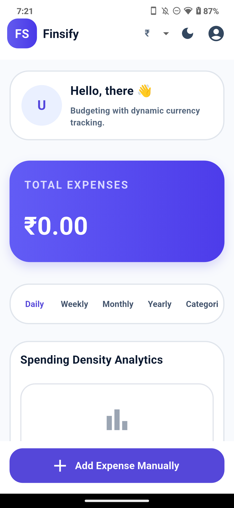
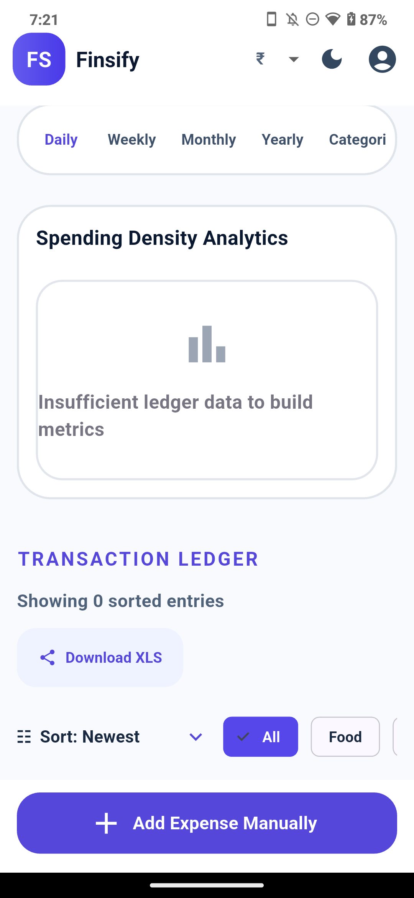
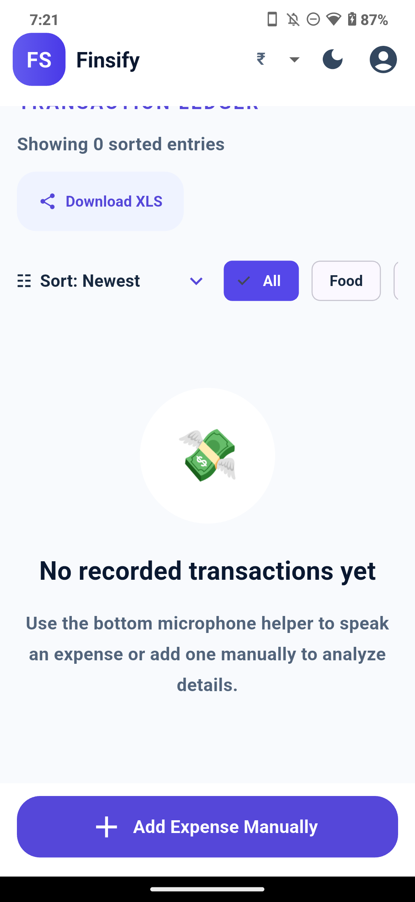
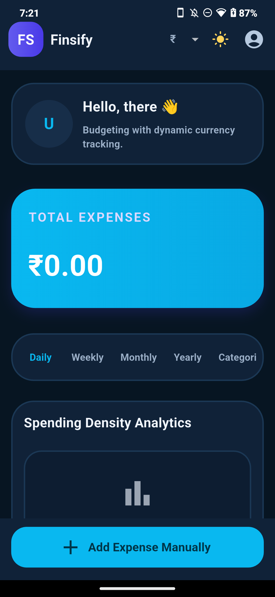
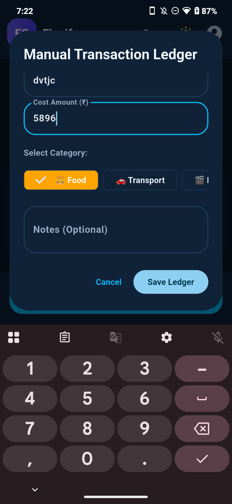
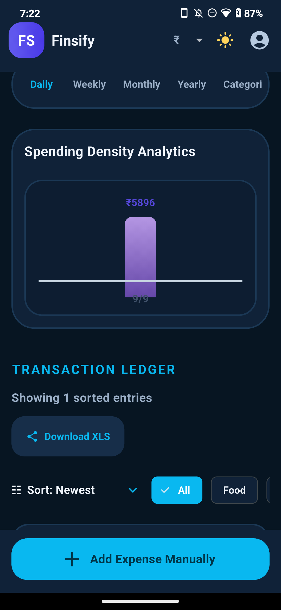

# Finsify

<p align="center">
  
</p>

<p align="center">
  <strong>A local-first personal finance tracker built with Flutter</strong>
</p>

<p align="center">
  <a href="#-features">Features</a> •
  <a href="#-tech-stack">Tech Stack</a> •
  <a href="#-architecture">Architecture</a> •
  <a href="#-project-structure">Project Structure</a> •
  <a href="#-getting-started">Getting Started</a> •
  <a href="#-screenshots">Screenshots</a> •
  <a href="#-documentation">Documentation</a>
</p>

---

## 🎯 About

**Finsify** is a personal finance tracker built with Flutter, with Android as the primary target. The repository also contains the original Kotlin/Android implementation under `Source/`. Flutter builds can target iOS, Web, and Desktop, but some device features are platform-specific as described below.

**Core philosophy:** Keep personal financial records on the device. The Flutter app has no account, cloud sync, Gemini integration, or telemetry.

---

## ✨ Features

### 💰 Expense Management
| Feature | Description |
|---------|-------------|
| **Manual Entry** | Add expenses with title, amount, category, date/time, and optional notes |
| **Edit & Delete** | Modify or remove any transaction |
| **Categories** | Food, Transport, Entertainment, Shopping, Health, Utilities, Miscellaneous |
| **Sorting** | Newest, Oldest, Amount High, Amount Low |
| **Filtering** | By category (case-insensitive) or show all |
| **Voice Entry (No AI parsing)** | Device speech recognition with local rule-based amount/category parsing and an editable preview; available speech services vary by device |
| **SMS Import (Android)** | On demand, checks up to 100 recent inbox messages and lets the user review candidates before importing |

### 🧭 Financial Planning
| Feature | Description |
|---------|-------------|
| **Investments** | Track stocks, mutual funds, bonds, debt and other holdings; SIP or one-time contributions, return assumptions and estimated value projections |
| **Loans & EMI** | Record principal, flat or reducing-balance interest, tenure and fees; calculate estimated EMI, interest and end date |
| **Bills** | Track credit/debit card and other bill amounts and due dates, with optional monthly recurrence |
| **Due Reminders** | Local notifications on Android and iOS, scheduled about every 24 hours before the due date; permission is requested when a bill is added |

### 📊 Analytics & Insights
- **Total Spend Hero Metric** — real-time sum of all expenses held in the current app session
- **Time-grouped Analytics** — Daily, Weekly, Monthly, Yearly bar charts
- **Category Analytics** — Breakdown by category with period navigator (day/week/month/year)
- **Currency Symbol Selector** — ₹, $, €, £, ¥ (display only, no conversion)

### 🔒 Privacy & Security
- **Local-First** — No Finsify backend or cloud sync
- **Local Preferences** — Investment, loan, and bill records are stored using `SharedPreferences`; expenses and profile details are currently held in memory and are not retained after the app process ends
- **No Tracking** — No analytics or crash reporting
- **SMS Privacy** — Inbox access is requested only when you choose import; results are reviewed on device and message text is not stored
- **Speech Privacy** — Expense parsing is local and does not use AI; transcription is provided by the device speech service, whose network behavior depends on platform settings

### 📤 Export
- **Excel Workbook** — Exports filtered expenses to `.xlsx` with date/time, category, title, amount, currency, and notes
- **Save Location** — Direct save to the Android Downloads folder; this export action is Android-only

### 🎨 Theming
- **Light Mode** — Pale slate background, indigo accents
- **Dark Mode** — Deep navy surfaces, cyan/blue accents
- **Motion** — Screen, analytics, chart, list, navigation, and button feedback transitions; respects the system reduced-motion setting

---

## 🏗️ Tech Stack

| Area | Flutter implementation |
|-------|-------------------------|
| **UI** | Flutter Widgets and Material 3 |
| **State** | `ChangeNotifier` controllers |
| **Expense Records** | In-memory for the current process |
| **Investments, Loans, Bills** | `SharedPreferences` on-device persistence |
| **Voice** | `speech_to_text` transcription and local rule-based parsing |
| **SMS** | Android inbox query with permission request and user review |
| **Notifications** | `flutter_local_notifications` with timezone scheduling |
| **Export** | `.xlsx` generation and Android Downloads method channel |

> **Platform notes:** SMS import is Android-only. Bill reminders support Android and iOS. Direct `.xlsx` saving is Android-only. Financial projections are estimates, not guarantees.

---

## 🏛️ Architecture

```
┌─────────────────────────────────────────────┐
│           Presentation Layer                │
│  main.dart: Splash → Profile → Dashboard    │
│  financial_pages.dart: investments, loans, bills
├─────────────────────────────────────────────┤
│           Controller Layer                  │
│  ExpenseController + FinancialController    │
├─────────────────────────────────────────────┤
│           Model Layer                       │
│  Expense, Investment, Loan, Bill             │
├─────────────────────────────────────────────┤
│           Service Layer                     │
│  Voice/SMS, reminders, XLSX generation      │
└─────────────────────────────────────────────┘
```

**Data flow:** `ExpenseController` manages in-memory expense CRUD, filtering, and sorting. `FinancialController` loads and saves investments, loans, and bills in `SharedPreferences`. Voice parsing is rule-based and local; SMS and reminders use device/platform services. No AI or network service is called by the Flutter app.

**Kotlin Source Reference (complete):**
```
Compose UI → ExpenseViewModel (StateFlow)
    → ExpenseRepository → ExpenseDao (Room Flow)
    → PreferencesManager (encrypted prefs)
    → CryptoManager (Android Keystore AES-GCM)
    → GeminiService (Retrofit) / VoiceRecognizerHelper
```

---

## 📁 Project Structure

```
finsify/
├── lib/
│   ├── main.dart                    # App entry, onboarding, dashboard and navigation
│   ├── controllers/                 # Expense and finance state
│   ├── models/                      # Expense, investment, loan and bill models
│   ├── services/                    # SMS, speech, reminders, and XLSX export
│   ├── theme/                       # Shared light/dark palette and Material themes
│   └── widgets/                     # Finance pages, chart and voice-entry dialog
├── test/
│   ├── analytics_bar_chart_test.dart
│   ├── financial_controller_test.dart
│   ├── financial_item_test.dart
│   ├── voice_expense_parser_test.dart
│   └── widget_test.dart
├── documents/                    # Project and migration documents
│   ├── features/                 # End-to-end guides for implemented Flutter features
│   │   └── README.md             # Feature guide index
│   ├── LOCAL_BUILD_RUN_DEPLOY_TROUBLESHOOTING.md
│   ├── ARCHITECTURE.md
│   ├── FLUTTER_MIGRATION_SPEC.md
│   ├── FINSIFY_MIGRATION_REPORT.md
│   ├── FRD.md                    # Functional Requirements
│   ├── TRD.md                    # Technical Requirements
│   ├── API_SPEC.md               # Original Kotlin Gemini API contract
│   ├── ERD.md                    # Entity Relationship Diagram
│   ├── SYSTEM_DESIGN.md
│   ├── UI_DESIGN.md
│   ├── UI_COMPONENT_ARCHITECTURE_SPEC.md
│   ├── TEST_SPEC.md
│   └── TRACEABILITY.md
├── android/                      # Flutter Android config
├── ios/                          # Flutter iOS config
├── web/                          # Flutter Web config
├── windows/ linux/ macos/        # Flutter Desktop scaffolding
├── Finsify_logo.png              # App icon
├── flutter_01.png ... flutter_22.png  # Screenshots
├── pubspec.yaml
├── analysis_options.yaml
└── README.md
```

---

## 🚀 Getting Started

### Prerequisites
- **Flutter SDK** matching the Dart constraint in `pubspec.yaml` (currently Dart `^3.13.2`)
- Android Studio / VS Code with Flutter plugin
- Android toolchain and an Android device/emulator for `flutter run`
- For Kotlin source: Android Studio and a compatible JDK/Android SDK

### Flutter App

```bash
# 1. Clone
git clone <your-repo-url>
cd finsify

# 2. Get dependencies
flutter pub get

# 3. Run
flutter run -d <device-id>   # android, ios, chrome, windows, macos, linux
```

**Implemented:**
- ✅ Splash → Profile onboarding → Dashboard
- ✅ Add/Edit/Delete expenses (in-memory)
- ✅ Filter by category, sort by 4 orders
- ✅ Analytics tabs (Daily/Weekly/Monthly/Yearly/Categories)
- ✅ Category period navigator with charts
- ✅ Light/Dark theme toggle for the current app session
- ✅ Currency symbol selector (₹/$/€/£/¥)
- ✅ Filtered expense export to an `.xlsx` file in Android Downloads
- ✅ Responsive breakpoints (<600px, <400px)
- ✅ Voice expense entry without AI parsing
- ✅ On-demand SMS transaction import on Android
- ✅ Locally stored investments, loans and bills with estimated return/EMI calculations
- ✅ Daily local bill due-date reminders on Android and iOS
- ✅ Screen and component transitions that respect reduced-motion preferences
- ✅ Unit + widget tests (`flutter test`)

**Current data lifecycle:** Expenses and profile data are session-only. Finance records persist locally in preferences. No cloud backup or secure-storage encryption is currently implemented.

### Kotlin Source App (Reference Implementation)

```bash
cd Source
./gradlew assembleDebug
# Install app/build/outputs/apk/debug/app-debug.apk
```

---

## 📸 Screenshots

| Splash | Profile Setup | Dashboard (Light) |
|--------|---------------|-------------------|
|  |  |  |

| Dashboard (Dark) | Add Expense Dialog | Analytics |
|------------------|----------------|-----------|
|  |  |  |

---

## 📚 Documentation

| Document | Purpose |
|----------|---------|
| [FRD.md](documents/FRD.md) | Functional requirements & user flows |
| [TRD.md](documents/TRD.md) | Technical requirements & build config |
| [ARCHITECTURE.md](documents/ARCHITECTURE.md) | Layer diagram, dependency direction, risks |
| [SYSTEM_DESIGN.md](documents/SYSTEM_DESIGN.md) | Runtime architecture and migration design |
| [FLUTTER_MIGRATION_SPEC.md](documents/FLUTTER_MIGRATION_SPEC.md) | Target structure, Kotlin→Dart mapping, compat rules |
| [FINSIFY_MIGRATION_REPORT.md](documents/FINSIFY_MIGRATION_REPORT.md) | Migration status, timeline, decisions, metrics |
| [API_SPEC.md](documents/API_SPEC.md) | Original Kotlin Gemini API contract (not used by Flutter) |
| [ERD.md](documents/ERD.md) | Database schema, prefs store, relationships |
| [UI_DESIGN.md](documents/UI_DESIGN.md) | Visual direction, screen map, interaction rules |
| [UI_COMPONENT_ARCHITECTURE_SPEC.md](documents/UI_COMPONENT_ARCHITECTURE_SPEC.md) | UI component architecture and implementation guidance |
| [TEST_SPEC.md](documents/TEST_SPEC.md) | Unit/widget/integration test matrix, acceptance scenarios |
| [TRACEABILITY.md](documents/TRACEABILITY.md) | Requirements ↔ source ↔ Flutter verification matrix |
| [Feature guides](documents/features/README.md) | End-to-end architecture, data models, APIs, flows, platform boundaries, and tests for each implemented Flutter feature |
| [Local build/run/deploy troubleshooting](documents/LOCAL_BUILD_RUN_DEPLOY_TROUBLESHOOTING.md) | Android/iOS setup, common build/runtime errors, platform limitations, and release checklists |

---

## 🧪 Testing

```bash
# Run all tests
flutter test

# Run static analysis
flutter analyze

# Build an Android debug APK
flutter build apk --debug

# Run with coverage
flutter test --coverage
genhtml coverage/lcov.info -o coverage/html
```

**Current coverage:** Chart layout and theme colors, finance calculations and persistence, local voice parsing, onboarding, dashboard navigation, dark-theme surfaces, and finance add flows.

---

## 🤝 Contributing

1. Fork the repository
2. Create a feature branch: `git checkout -b feature/your-feature`
3. Follow the existing code style (`flutter analyze`, `dart format`)
4. Add tests for new functionality
5. Ensure all tests pass: `flutter test`
6. Open a Pull Request with a clear description

---

## 📄 License

No `LICENSE` file is currently present in the repository. Confirm the license terms before reuse or distribution.

---

## 🙏 Acknowledgments

- **Flutter Team** — Excellent cross-platform framework
- **Material 3** — Beautiful, accessible design system

---

## 📞 Support

- **Issues**: GitHub Issues tab
- **Discussions**: GitHub Discussions
- **Documentation**: `documents/` folder

---

<p align="center">
  Made with ❤️ using Flutter
</p>
