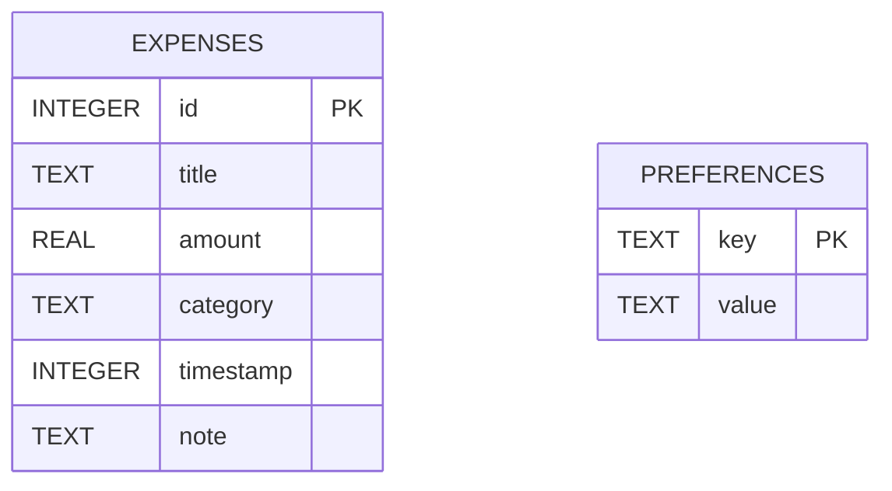

# Entity Relationship Diagram - Expensify

## 1. Storage Model

The current application has one relational table and one independent key-value preference store. It is single-user and local-only. There are no foreign keys or relational joins.

## 2. Room Entity: `expenses`

| Column | SQLite type | Constraints | Meaning |
| --- | --- | --- | --- |
| `id` | INTEGER | Primary key, auto-generated | Expense identifier |
| `title` | TEXT | Not null | Short purchase description |
| `amount` | REAL | Not null | Numeric cost |
| `category` | TEXT | Not null | One of the fixed categories, normally |
| `timestamp` | INTEGER | Not null | Epoch milliseconds |
| `note` | TEXT | Default empty string | Optional context |

The Kotlin model is `Expense`. The DAO returns all rows ordered by `timestamp DESC`. Application filtering and sorting are performed in `ExpenseViewModel`, not SQL.

## 3. Preference Store: `expense_tracker_prefs`

| Key | Type | Protection |
| --- | --- | --- |
| `preferred_currency` | String | Plain preference, default `₹` |
| `onboarding_completed` | Boolean | Plain preference, default `false` |
| `dark_theme_enabled` | Boolean | Plain preference, default `false` |
| `user_name_enc` | String | AES-GCM ciphertext in Base64 |
| `user_email_enc` | String | AES-GCM ciphertext in Base64 |
| `user_bio_enc` | String | AES-GCM ciphertext in Base64 |
| `custom_api_key_enc` | String | AES-GCM ciphertext in Base64 |

The encrypted values are associated with the single local profile. They are not rows in the Room database.

## 4. Logical Relationships

There is no database relationship between `EXPENSES` and `PREFERENCES`; the ViewModel combines them at runtime to format the dashboard and associate expenses with the local profile.

## 5. Integrity Notes

The model does not enforce category values, positive amounts, or timestamp ranges at the database level. UI and ViewModel validation should enforce those rules if they become formal product requirements. `fallbackToDestructiveMigration()` can delete existing rows when the schema version changes.