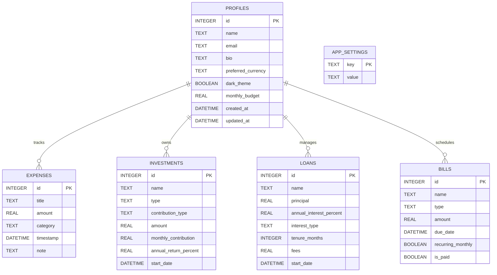

# Entity Relationship Diagram - Finsify

## 1. Storage Architecture

Finsify uses a local-first, relational SQLite database managed via [Drift](https://drift.simonbinder.eu/) (version 2.x). 
- **Native Platforms (Android, iOS, Windows, macOS, Linux):** SQLite database stored in application documents directory as `finsify.sqlite`.
- **Web Platform:** SQLite running in WebAssembly (`sqlite3.wasm` and `drift_worker.js`) persisting to browser IndexedDB via `WasmStorageImplementation.sharedIndexedDb`.
- **Testing:** `NativeDatabase.memory()` in-memory SQLite instances for hermetic unit and widget testing.

## 2. Logical Data Model

---

## 3. Database Tables

### 3.1 `profiles`
Stores the local user identity, interface preferences, and monthly budget target.

| Column | Drift / SQLite Type | Constraints | Default | Meaning |
|---|---|---|---|---|
| `id` | INTEGER | PRIMARY KEY AUTOINCREMENT | Generated | Profile identifier |
| `name` | TEXT | NOT NULL | - | Full name |
| `email` | TEXT | NOT NULL | - | Contact email |
| `bio` | TEXT | NOT NULL | `''` | Profile bio / notes |
| `preferred_currency` | TEXT | NOT NULL | `'₹'` | Currency symbol (`₹`, `$`, `€`, `£`) |
| `dark_theme` | BOOLEAN | NOT NULL | `FALSE` | Theme mode preference |
| `monthly_budget` | REAL | NULLABLE | `NULL` | Monthly spending limit |
| `created_at` | DATETIME | NOT NULL | `DateTime.now()` | Profile creation timestamp |
| `updated_at` | DATETIME | NOT NULL | `DateTime.now()` | Last modification timestamp |

### 3.2 `expenses`
Stores ledger transactions entered manually, imported via SMS, or captured by voice.

| Column | Drift / SQLite Type | Constraints | Default | Meaning |
|---|---|---|---|---|
| `id` | INTEGER | PRIMARY KEY AUTOINCREMENT | Generated | Expense record identifier |
| `title` | TEXT | NOT NULL | - | Item or merchant name |
| `amount` | REAL | NOT NULL | - | Cost in user's active currency |
| `category` | TEXT | NOT NULL | - | Category (`Food`, `Transport`, etc.) |
| `timestamp` | DATETIME | NOT NULL | - | Date and time transaction occurred |
| `note` | TEXT | NOT NULL | `''` | Optional context or metadata |

### 3.3 `app_settings`
Generic key-value store for system preferences, onboarding completion, and flag states.

| Column | Drift / SQLite Type | Constraints | Meaning |
|---|---|---|---|
| `key` | TEXT | PRIMARY KEY | Unique setting identifier |
| `value` | TEXT | NOT NULL | Setting value (string, boolean, or JSON) |

### 3.4 `investments`
Tracks assets, stocks, mutual funds, bonds, and projected returns.

| Column | Drift / SQLite Type | Constraints | Default | Meaning |
|---|---|---|---|---|
| `id` | INTEGER | PRIMARY KEY AUTOINCREMENT | Generated | Investment record ID |
| `name` | TEXT | NOT NULL | - | Asset or holding name |
| `type` | TEXT | NOT NULL | - | `stocks`, `mutualFunds`, `bonds`, `debt`, `other` |
| `contribution_type` | TEXT | NOT NULL | - | `sip` or `oneTime` |
| `amount` | REAL | NOT NULL | - | Initial invested capital |
| `monthly_contribution` | REAL | NOT NULL | `0.0` | Monthly SIP amount |
| `annual_return_percent` | REAL | NOT NULL | - | Expected annual return rate (%) |
| `start_date` | DATETIME | NOT NULL | - | Investment commencement date |

### 3.5 `loans`
Tracks mortgages, auto loans, personal debt, and EMI parameters.

| Column | Drift / SQLite Type | Constraints | Default | Meaning |
|---|---|---|---|---|
| `id` | INTEGER | PRIMARY KEY AUTOINCREMENT | Generated | Loan record ID |
| `name` | TEXT | NOT NULL | - | Loan or lender description |
| `principal` | REAL | NOT NULL | - | Total borrowed amount |
| `annual_interest_percent` | REAL | NOT NULL | - | Annual interest rate (%) |
| `interest_type` | TEXT | NOT NULL | - | `reducingBalance` or `flat` |
| `tenure_months` | INTEGER | NOT NULL | - | Repayment period in months |
| `fees` | REAL | NOT NULL | `0.0` | Upfront administrative/processing fees |
| `start_date` | DATETIME | NOT NULL | - | First repayment date |

### 3.6 `bills`
Tracks upcoming payables, credit card dues, and recurring billing.

| Column | Drift / SQLite Type | Constraints | Default | Meaning |
|---|---|---|---|---|
| `id` | INTEGER | PRIMARY KEY AUTOINCREMENT | Generated | Bill record ID |
| `name` | TEXT | NOT NULL | - | Bill or creditor name |
| `type` | TEXT | NOT NULL | - | `creditCard`, `debitCard`, `other` |
| `amount` | REAL | NOT NULL | - | Due amount |
| `due_date` | DATETIME | NOT NULL | - | Payment deadline |
| `recurring_monthly` | BOOLEAN | NOT NULL | `FALSE` | Monthly recurrence flag |
| `is_paid` | BOOLEAN | NOT NULL | `FALSE` | Payment settlement status |

---

## 4. Integrity and Migrations

- **Schema Versioning:** Managed through Drift `schemaVersion` (currently version 1).
- **Migration Strategy:** The Drift database class implements typed migration routines for future schema modifications.
- **Legacy Migration:** Previous versions storing data in `SharedPreferences` are automatically migrated to SQLite on first initialization without data loss.
