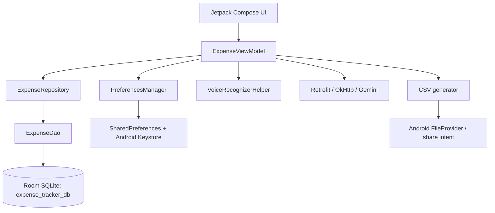

# System Design - Expensify

## 1. Runtime Architecture

## 2. Application Startup

`MainActivity` enables edge-to-edge rendering, creates the `ExpenseViewModel`, observes the dark-theme `StateFlow`, and hosts Compose content. `MainAppHost` shows splash, waits 2.5 seconds, then routes to onboarding or dashboard based on `PreferencesManager.hasCompletedOnboarding()`.

## 3. State and Data Flow

1. Room emits all expenses as a `Flow`.
2. The repository exposes the flow to the ViewModel.
3. The ViewModel combines expenses with currency, sort order, and category filter state.
4. Compose collects the resulting state and redraws the dashboard.
5. CRUD methods launch coroutine work in `viewModelScope`.
6. Aggregate methods calculate totals and day/week/month/year groupings from the in-memory list.

## 4. AI Flow

The voice helper manages Android speech-recognition lifecycle and exposes listening, transcript, and error state. The ViewModel sends a transcript to Gemini, extracts the first JSON object from the response, and returns parsed fields for user confirmation. Insights use the latest 30 expenses and are rendered as returned markdown text.

## 5. Export Flow

The repository formats expenses as CSV, including date formatting and field escaping. `MainActivity` writes/shares the generated content through Android storage/share APIs. The current implementation does not construct an OpenXML ZIP or XLSX workbook.

## 6. Failure and Recovery

- Missing microphone permission or unavailable speech service stops voice capture with a visible error.
- Missing/placeholder Gemini key prevents network work and leaves manual entry available.
- Retrofit failures populate AI error state.
- Crypto failures resolve to an empty profile value.
- Database migration fallback is destructive and must be replaced before production.